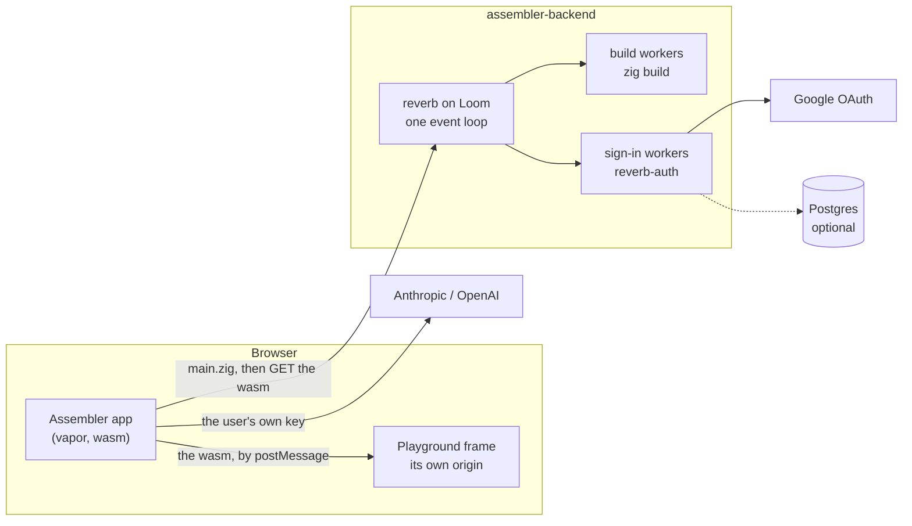

# assembler-backend

[](https://github.com/vic-Rokx/assembler-backend/actions/workflows/ci.yml)

The server behind [Assembler](https://github.com/vic-Rokx/assembler-chat), a
[vapor](https://github.com/senet-toolbox/vapor) app for writing vapor apps:
describe a UI to a model, get Zig back, and run it in the browser. This
backend compiles that code to WebAssembly, serves the result, and signs
people in with Google. It is written in Zig 0.16 on
[reverb](https://github.com/senet-toolbox/reverb), an HTTP server on the
[Loom](https://github.com/tether-labs/Loom) event loop.


## What it serves

| Route | |
| --- | --- |
| `POST /api/wasm/build` | The body is a `main.zig`. Answers `200` with a build id, `500` with the compiler's `file:line:col: error: ...` lines, or `503` when the build queue is full. |
| `GET /api/wasm/build/<id>.wasm` | The build, as `application/wasm`. |
| `GET /api/wasm/versions` | `{"zig": "0.16.0", "vapor": "3.1.3"}`: what code is built with. |
| `POST /exchange/google/token`, `/auth/session/{bootstrap,refresh,signout}`, `/auth/validate/google/session` | Google sign-in for vapor's KeyStone, when configured. |
| `POST /chat`, `POST /api/vertex` | A prompt answered by Claude with the server's own credentials, for self-hosting. |
| `GET /` | `SUCCESS`. |

Users' model keys never come here. The app keeps them in the browser and
sends them only to Anthropic or OpenAI.

## How it works



- **Nothing slow runs on the event loop.** A build takes seconds and a
  sign-in waits on Google, so their handlers defer the reply
  (`ctx.deferReply()`) and hand the work to a worker pool
  (`reverb.Workers`); the loop keeps answering everyone else. The pool
  sizes are the concurrency caps, and a full queue answers `503` at once.
  Both pieces were added to reverb and Loom for this backend.
- **Builds are contained.** Each one gets its own folder, made from a fixed
  template pinned to vapor 3.1.3 (`playground_template/`). A request
  supplies only `src/main.zig`, never a path or a build option. A build
  that passes its deadline has its whole process group killed. The
  compiler's output is cut down to the diagnostics, without the server's
  paths. Finished builds are swept after an hour.
- **The playground runs on its own origin.** Users keep their keys in the
  app's `localStorage`, and the code in the frame could otherwise read
  them. The app hands the frame the compiled bytes over `postMessage`
  (vapor's `data-vapor-boot="playground"`).
- **Sign-in is Google's,** through
  [reverb-auth](https://github.com/senet-toolbox/reverb-auth). The id
  token's audience, issuer and expiry are checked, and the session is an
  `HttpOnly`, `SameSite=Lax` cookie. Postgres is optional: with
  `DATABASE_URL` each user is recorded, and without it nothing is stored.

## Run it

Zig 0.16.0.

```sh
zig build run            # http://localhost:8080
```

With the app, from a checkout of
[assembler-chat](https://github.com/vic-Rokx/assembler-chat):

```sh
zig build site && node scripts/serve.mjs   # app on :5173, frame on :5174
```

Settings come from the environment or a git-ignored `.env`; see
[`.env.example`](.env.example). Google sign-in needs your own OAuth client
with `http://localhost:5173/auth/callback` as a redirect URI.

### In a container

```sh
docker build -t assembler-backend .
docker run -p 8080:8080 --env-file .env assembler-backend
```

The image carries the Zig toolchain and has vapor already compiled into its
cache, so the first build is as fast as the rest. Give it 2 GB of memory or
more.

### Hosting

The app is static files (`zig build site` in assembler-chat), so any static
host will do. It goes on two hostnames of one site: the app on, for
example, `app.example.com`, and the same files on `play.example.com` for the
frame. Build the app with
`-Dbackend_base_url=https://api.example.com
-Dplayground_url=https://play.example.com/playground.html`, run this
container on `api.example.com` with `HOST=0.0.0.0`,
`ALLOWED_ORIGIN=https://app.example.com`, `SECURE_COOKIES=1` and
`OAUTH_REDIRECT_URI=https://app.example.com/auth/callback`, and add that
redirect URI to the Google client. Being one site is what lets `Lax`
cookies work. A frontend on another site needs `COOKIE_SAMESITE=none`.

## Tests

```sh
zig build test
```

These run the real routes over a socket, with real playground builds and a
fake Google token endpoint. The four tests that need a database use the one
in `TEST_DATABASE_URL`, and are skipped, saying so, when none answers:

```sh
docker run -d --name assembler-pg -e POSTGRES_PASSWORD=postgres \
  -e POSTGRES_DB=assembler_test -p 127.0.0.1:54329:5432 postgres:17
```

The end-to-end tests drive the app in headless Chrome (Node 22 or later):

```sh
SITE=../assembler-chat node tests/browser/playground.mjs
SITE=../assembler-chat node tests/browser/signin.mjs
```

`playground.mjs` builds the sample and waits for it to render in the frame.
It checks the frame cannot read the app's storage, and that a compile error
on line 300 is underlined. `signin.mjs` signs in with Google played by the
test, then checks the signed-in page and signing out.

Each test names the bug it exists to catch, and was shown to fail with that
bug put back.

## Built with

| | |
| --- | --- |
| [reverb](https://github.com/senet-toolbox/reverb) | HTTP: routing, CORS, deferred replies, worker pools |
| [Loom](https://github.com/tether-labs/Loom) | The kqueue/epoll event loop under reverb |
| [reverb-auth](https://github.com/senet-toolbox/reverb-auth) | Google sign-in and sessions |
| [vapor](https://github.com/senet-toolbox/vapor) | What the playground builds against |
| [claude-zig](https://github.com/senet-toolbox/claude-zig) | Claude and Vertex clients |
| [pg-orm](https://github.com/senet-toolbox/pg-orm) | The users table's schema |
